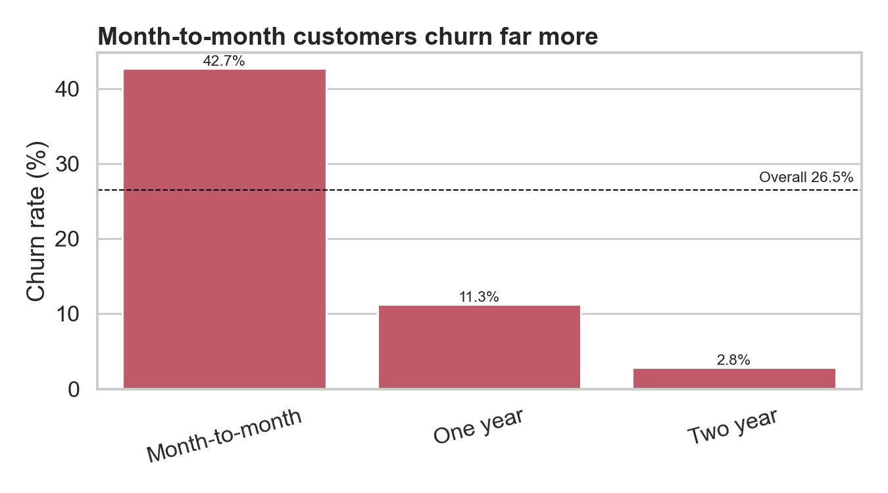
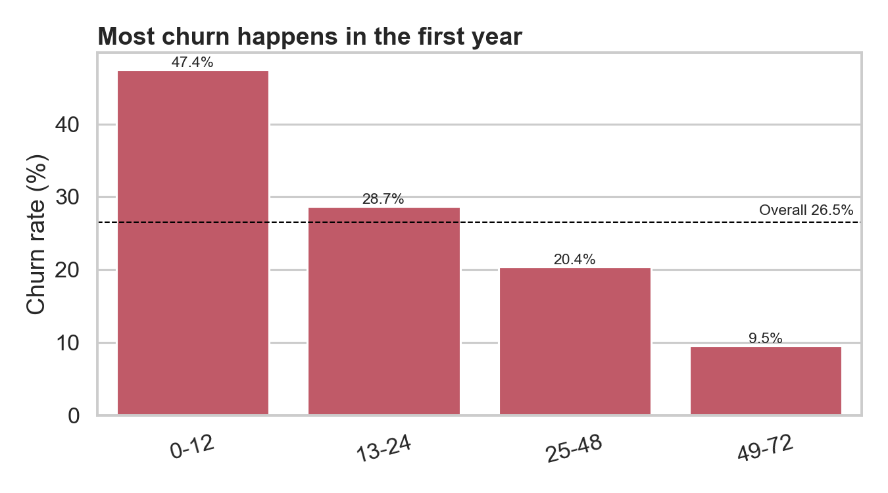
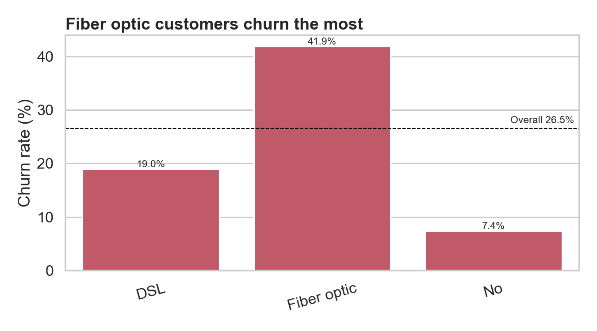
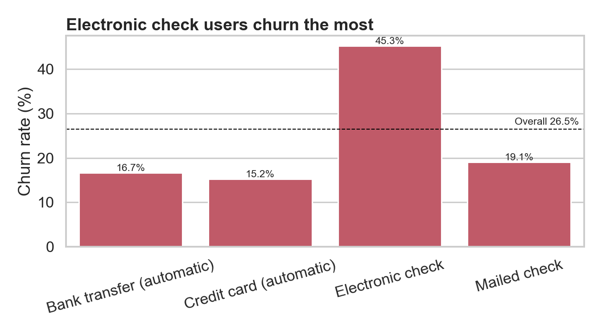
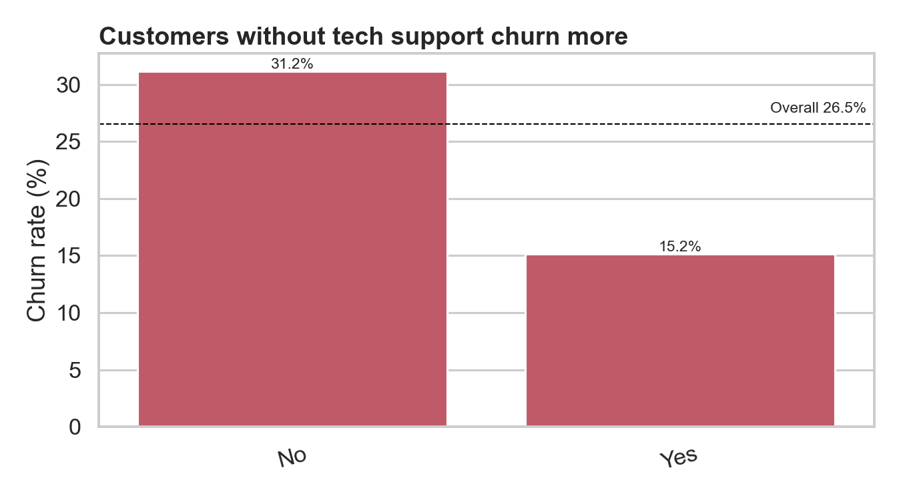
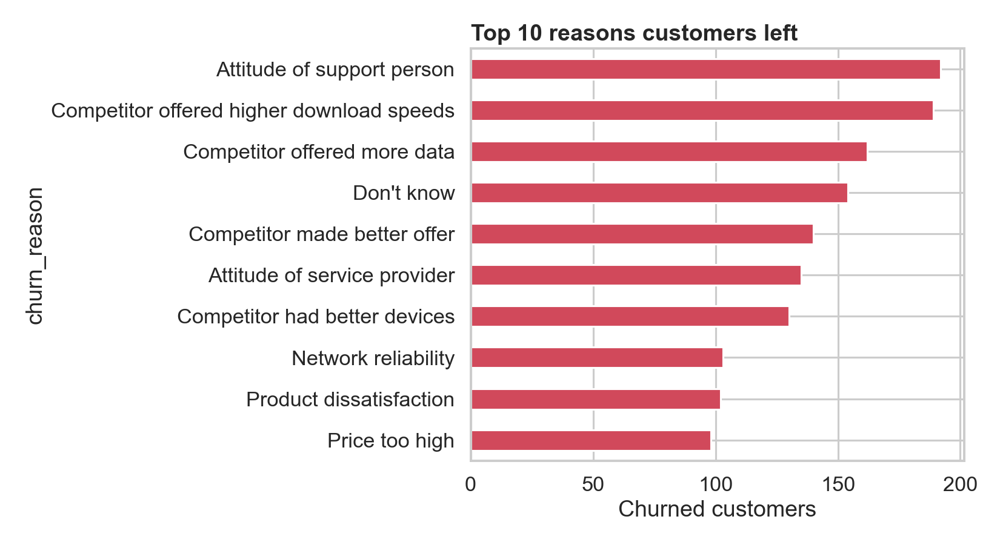
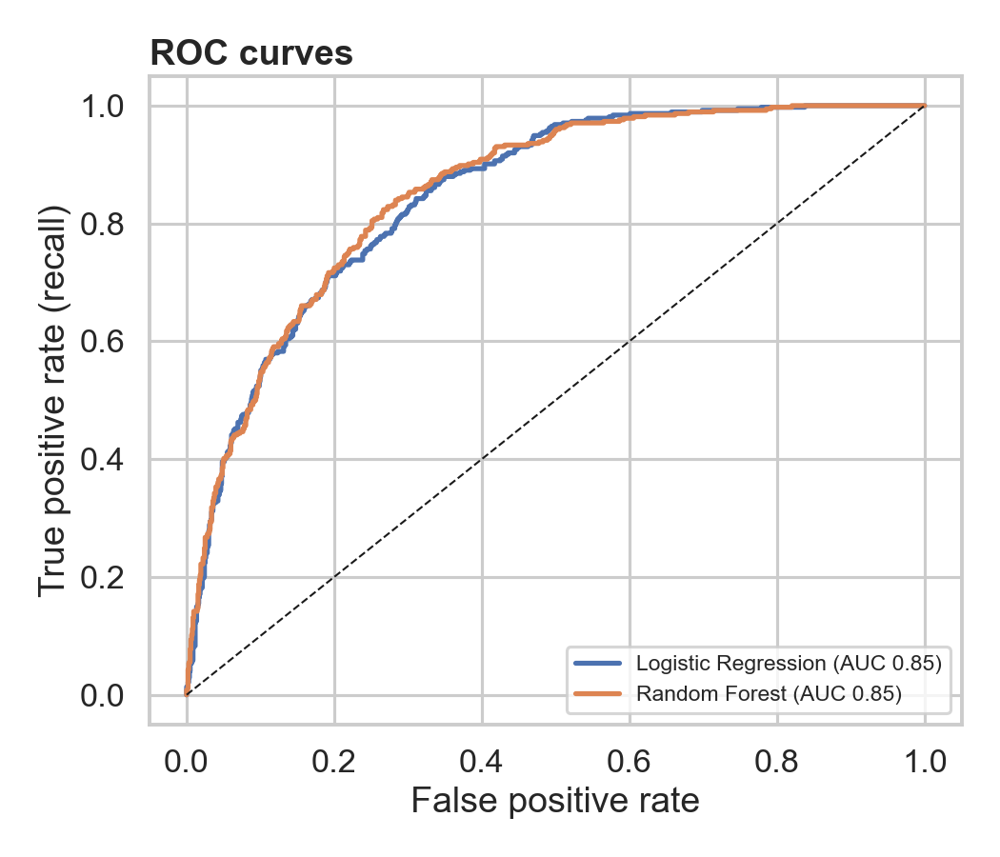
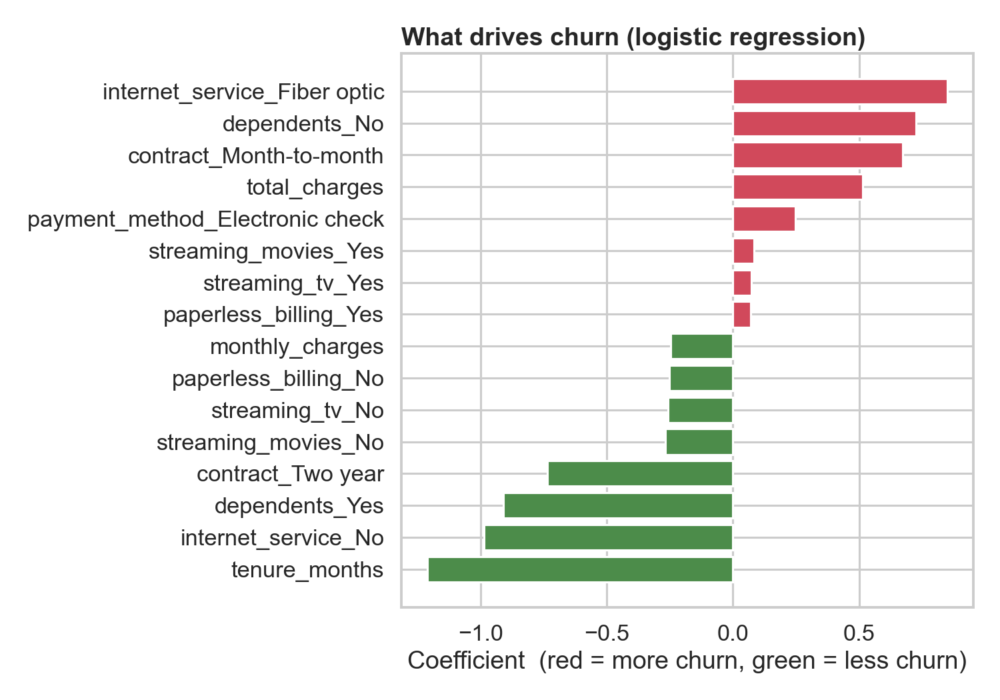

# Customer Churn Analysis and Retention Strategy

**Who is leaving, why, and what should the company do about it?**

I analyzed 7,043 telecom customers using SQL and Python, found what drives churn, built a model to flag at-risk customers, and estimated the revenue at stake.

## Key findings

- **26.5% of customers churned** (1,869 of 7,043), costing **$139,131 in monthly revenue (30.5% of the total)**, about **$1.67M annualized**.
- **Contract type is the strongest signal:** month-to-month customers churn at **42.7%**, versus 11.3% on one-year and 2.8% on two-year contracts.
- **Churn is an early-life problem:** customers in their first 12 months churn at **47.4%**, falling to 9.5% after four years.
- **New month-to-month customers (12 months or less) are the core problem:** 1,994 customers, 51.4% churn, and **54.8% of all churn**.
- **A model flags at-risk customers:** the High-risk tier holds 1,303 customers, **68.4% of whom actually churned**, and covers 47.7% of all churners.
- **Estimated payoff of a targeted retention campaign:** about **$131.6K net per year**, under stated assumptions (see [Business impact](#business-impact)).



## Dataset

[IBM Telco Customer Churn](https://community.ibm.com/community/user/blogs/steven-macko/2019/07/11/telco-customer-churn-1113) sample dataset: 7,043 customers of a fictional California telecom company, with demographics, services, contract, billing, and a churn label. The extended version also has `Churn Reason` and `CLTV`.

## Tools

Python (pandas, scikit-learn, matplotlib, seaborn), SQL (MySQL / SQLite), Streamlit and Plotly for the dashboard.

## Project structure

```
churn-analysis/
├── README.md
├── requirements.txt
├── 01_cleaning.py          # clean data, add features, load into SQLite
├── churn_queries.sql       # 10 business questions in SQL
├── 02_eda.py               # exploratory analysis and charts
├── 03_modeling.py          # logistic regression and random forest, risk scores
├── app.py                  # Streamlit dashboard
├── data/                   # raw data and generated files
└── reports/figures/        # charts used below
```

## Approach

1. **Cleaning:** fixed `Total Charges` (stored as text; the blank values were brand-new customers with 0 months of tenure), standardized column names, merged "No internet service" and "No phone service" into "No", and engineered tenure buckets and a services count.
2. **SQL analysis:** answered 10 business questions on churn by contract, tenure, payment method and services, revenue lost, and churn reasons.
3. **EDA:** charts for each driver (below).
4. **Modeling:** stratified 80/20 train/test split, balanced class weights for the 26.5% churn imbalance, and **no target leakage** (excluded `Churn Reason`, `Churn Score` and `Churn Label`, which are only known after a customer leaves or come from IBM's own model).
5. **Business impact:** scored every customer with out-of-fold predictions, grouped them into Low, Medium and High risk, and estimated the value of a retention campaign.

## What drives churn

| Driver | Result |
|---|---|
| Contract | Month-to-month **42.7%**, one year 11.3%, two year 2.8% |
| Tenure | 0-12 months **47.4%**, 13-24 months 28.7%, 25-48 months 20.4%, 49-72 months 9.5% |
| Internet service | Fiber optic **41.9%**, DSL 19.0%, no internet 7.4% |
| Payment method | Electronic check **45.3%**, mailed check 19.1%, bank transfer 16.7%, credit card 15.2% (the last two are automatic) |
| Tech support | No tech support 31.2%, with tech support 15.2% |

- Churned customers pay **more per month ($74.4 vs $61.3)** but have **about half the tenure (18.0 vs 37.6 months)**.
- Tenure has the strongest correlation with churn (**-0.35**); monthly charges are weaker (**0.19**).
- The most common reasons given for leaving were poor support attitude (192 customers) and competitor offers on download speed (189), data (162) and overall better deals (140).

| | |
|---|---|
|  |  |
|  |  |



## Predictive model

Two models were compared on a held-out test set of 1,409 customers (374 churners). Because only 26.5% of customers churn, a model that predicts "nobody leaves" would be 73.5% accurate and useless, so I report **recall and precision for churners** instead of accuracy.

Model comparison (test set):
                      precision  recall     f1  roc_auc  accuracy
model                                                           
Logistic Regression      0.511   0.781  0.618    0.849     0.744
Random Forest            0.558   0.730  0.633    0.853     0.775
Baseline 'nobody churns' accuracy: 0.735 (recall = 0)

Best model by ROC-AUC: Random Forest (5-fold out-of-fold AUC = 0.859)

**Choosing an action threshold.** The best model's probability threshold controls how many customers get contacted:

| Threshold | Customers flagged | Precision | Recall |
|---|---|---|---|
| 0.3 | 718 | 0.47 | 0.90 |
| 0.4 | 600 | 0.52 | 0.83 |
| **0.5** | **489** | **0.56** | **0.73** |
| 0.6 | 387 | 0.61 | 0.63 |
| 0.7 | 270 | 0.67 | 0.48 |

A low threshold catches more churners but wastes more offers; a high threshold is cheaper but misses more. The right choice depends on the cost of a retention offer.

**Drivers in the logistic regression** (largest coefficients): month-to-month contract (+0.67), fiber optic internet (+0.85), no dependents (+0.73) and electronic check payment (+0.25) raise churn risk; longer tenure (-1.21), no internet service (-0.99), having dependents (-0.91) and a two-year contract (-0.74) lower it. Coefficients on the numeric features (tenure, monthly and total charges) are correlated with each other, so read them as direction, not exact effect size.




## Recommendations

1. **Move new month-to-month customers onto annual contracts.** They are 1,994 customers with 51.4% churn and 54.8% of all churn. Offer a discount or a free add-on in exchange for a 12-month commitment, ideally in the first 90 days.
2. **Fix the fiber optic and electronic check segments.** Both churn above 40%. Investigate fiber pricing and service quality, and nudge electronic check users toward automatic payment (15% to 17% churn).
3. **Bundle tech support and improve support quality.** Customers without tech support churn at twice the rate (31.2% vs 15.2%), and support attitude was the most common reason for leaving.

## Business impact

Using out-of-fold predictions for all customers, the **High-risk tier** contains **1,303 customers**; **68.4%** of them actually churned, and the tier covers **47.7%** of all churners. Those churners held **$853,478** in annual revenue.

| Assumption (editable in `03_modeling.py` and the dashboard) | Value |
|---|---|
| Share of at-risk customers a retention offer keeps | 20% |
| Cost per customer contacted | $30 |

| Result | Value |
|---|---|
| Annual revenue retained | $170,696 |
| Campaign cost (1,303 contacts) | $39,090 |
| **Net benefit per year** | **$131,606** |

These two assumptions are illustrative, not measured from the data; a real campaign should test them with an A/B test before rollout.

## Dashboard

## Dashboard

An interactive **Power BI** dashboard (`reports/figures/dashboard.png`) with a contract slicer, churn drivers by tenure, internet service and payment method, top churn reasons, and a retention scenario.

A Streamlit version is also included: run `streamlit run app.py`.

`[Dashboard](reports/figures/dashboard.png)`

## Limitations

- The data is a single snapshot of a **fictional** company, so results show method and approach, not a real business.
- The analysis shows association, not causation: fiber customers may churn because of price, service quality, or something else.
- Business impact depends on assumed save rate and offer cost.
- The model was validated on one random split plus cross-validation, not on future data.

## How to run

```bash
pip install -r requirements.txt
# put Telco_customer_churn.xlsx in data/
python 01_cleaning.py
python 02_eda.py
python 03_modeling.py
streamlit run app.py
```

SQL queries are in `churn_queries.sql` (written for SQLite; they also run in MySQL).
